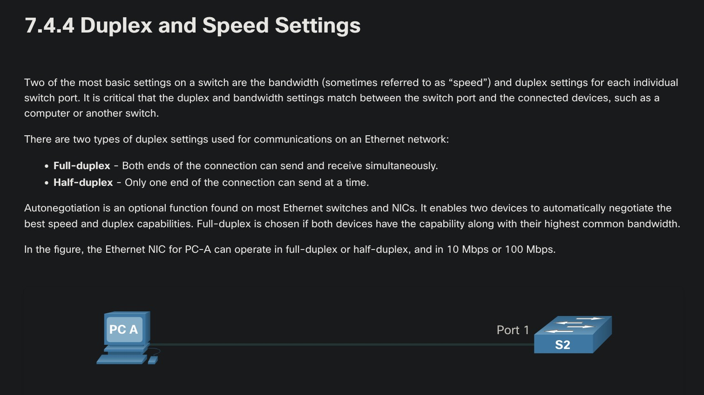
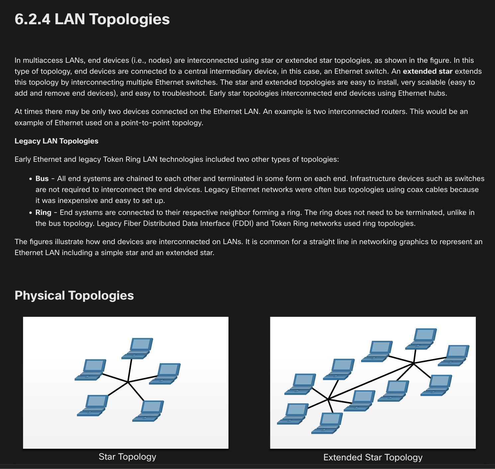
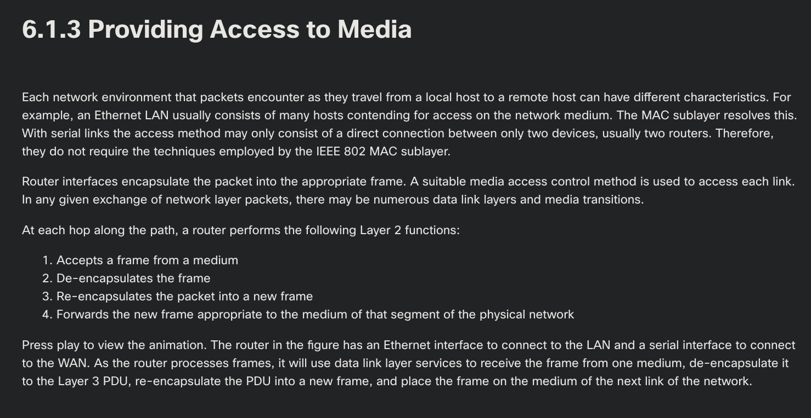
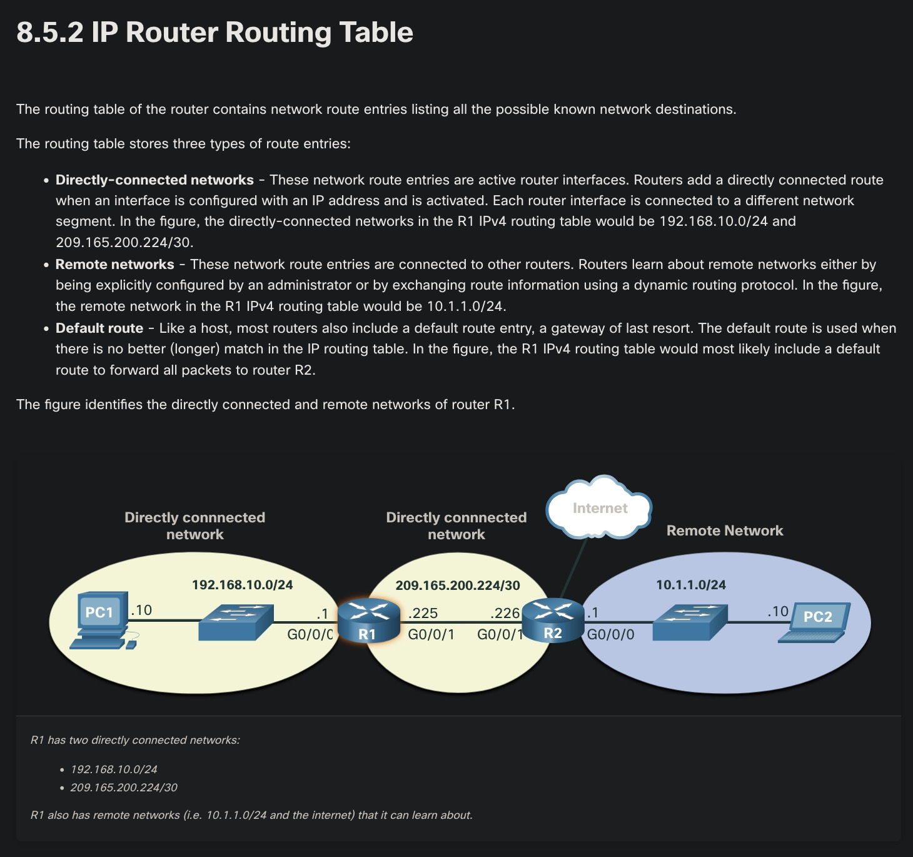
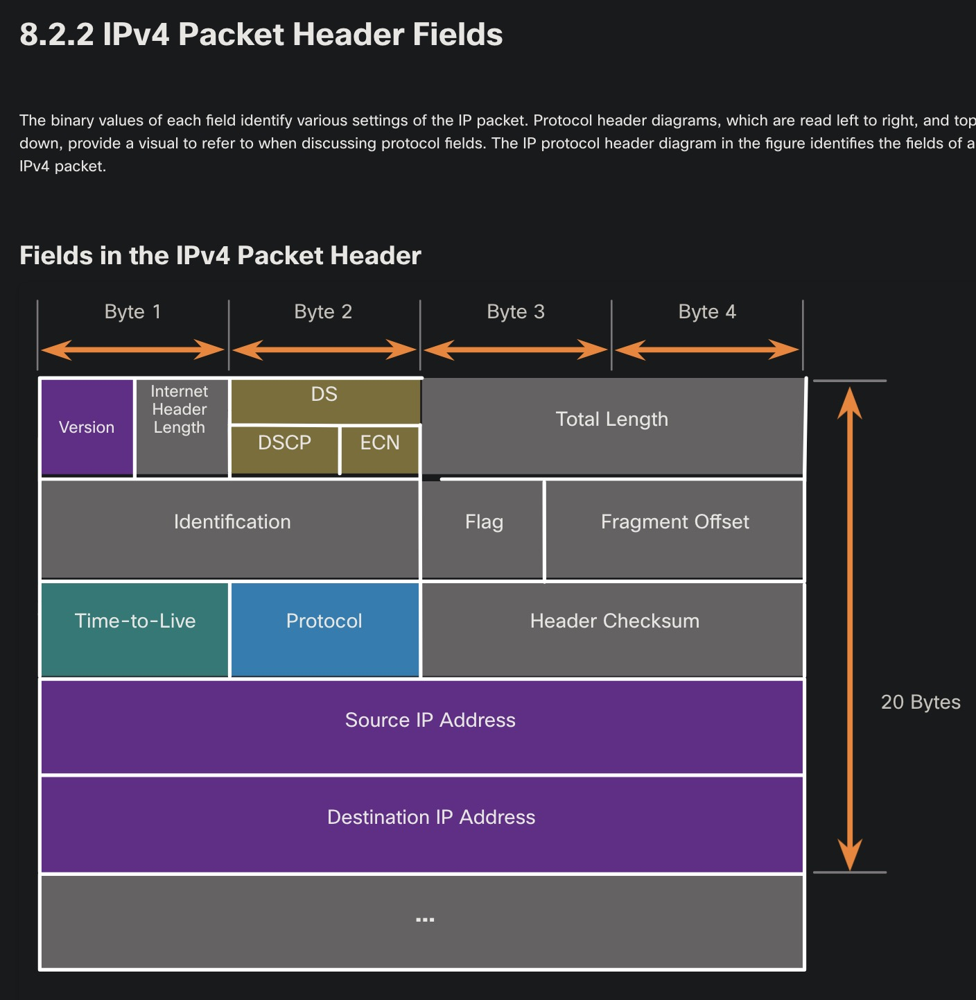
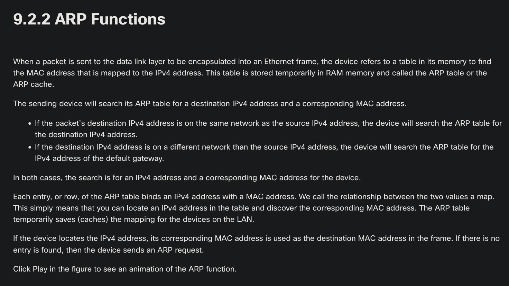
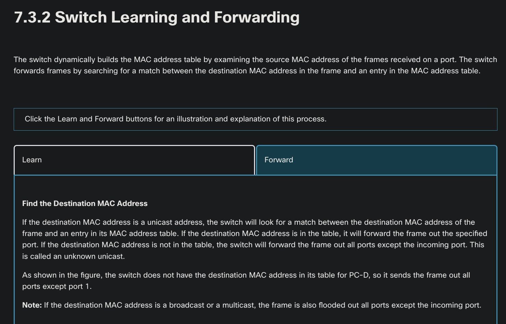
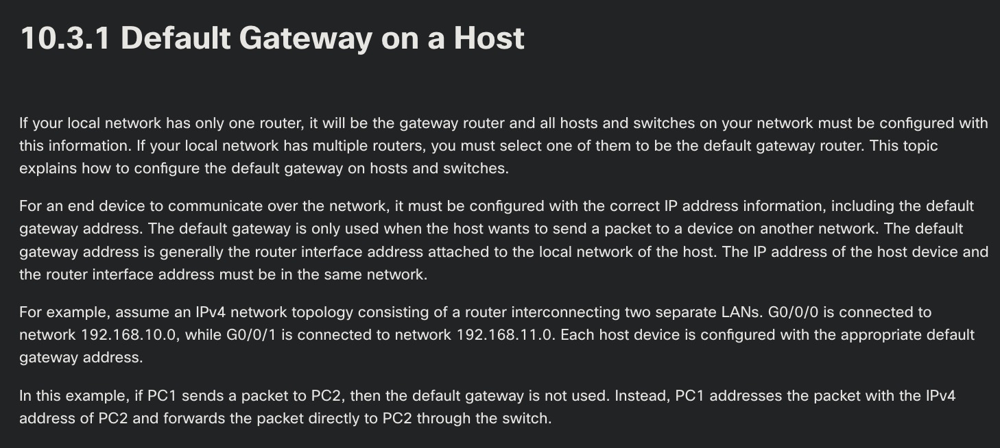

Profesor: Juan Manuel Campos Sandoval

---

1. Which two statements describe the characteristics of fiber-optic cabling? (Choose two.)
    - Respuesta: Fiber-optic cabling does not conduct electricity.
    - Respuesta: Fiber-optic cabling is primarily used as backbone cabling.
    - Los hilos de vidrio aislante transmiten pulsos luminosos inmunes a la interferencia electromagnética.
    - Su alto ancho de banda convierte a la fibra en el medio principal para enlaces troncales.

2. Although CSMA/CD is still a feature of Ethernet, why is it no longer necessary?
    - Respuesta: the use of full-duplex capable Layer 2 switches
    - Los switches de Capa 2 operan en dúplex completo y permiten la transmisión bidireccional simultánea sin colisiones en el medio.

3. Which two acronyms represent the data link sublayers that Ethernet relies upon to operate? (Choose two.)
    - Respuesta: MAC
    - Respuesta: LLC
    - El estándar IEEE 802 divide la capa de enlace de datos en las subcapas LLC y MAC.

4. A network team is comparing topologies for connecting on a shared media. Which physical topology is an example of a hybrid topology for a LAN?
    - Respuesta: extended star
    - La topología en estrella extendida interconecta switches centrales con múltiples switches de acceso en una estructura híbrida.

5. What does a router do when it receives a Layer 2 frame over the network medium?
    - Respuesta: de-encapsulates the frame
    - El router retira el encabezado y el tráiler de Capa 2 para leer el paquete IP contenido en la trama.

6. What routing table entry has a next hop address associated with a destination network?
    - Respuesta: remote routes
    - Las rutas remotas dirigen el tráfico hacia redes no locales mediante la dirección IP del siguiente router en la ruta.

7. Which term describes a field in the IPv4 packet header that contains a unicast, multicast, or broadcast address?
    - Respuesta: destination IPv4 address
    - El campo de dirección IPv4 de destino almacena los 32 bits que identifican al receptor individual, de grupo o de difusión.

8. Refer to the exhibit. PC1 issues an ARP request because it needs to send a packet to PC3. In this scenario, what will happen next?
    - Respuesta: RT1 will send an ARP reply with its own Fa0/0 MAC address.
    - PC1 debe enviar el paquete fuera de su subred local y solicita la dirección MAC de la interfaz Fa0/0 del router RT1.

9. Refer to the exhibit. The exhibit shows a small switched network and the contents of the MAC address table of the switch. PC1 has sent a frame addressed to PC3. What will the switch do with the frame?
    - Respuesta: The switch will forward the frame to all ports except port 4.
    - Al no encontrar la dirección MAC de PC3 en su tabla, el switch inunda la trama por todos los puertos activos excepto el puerto 4 de entrada.

10. Match the command with the device mode at which the command is entered.
    - Respuesta: service password-encryption -> R1(config)#
    - Respuesta: enable -> R1>
    - Respuesta: copy running-config startup-config -> R1#
    - Respuesta: login -> R1(config-line)#
    - Respuesta: ip address 192.168.4.4 255.255.255.0 -> R1(config-if)#
    - Cada comando de Cisco IOS pertenece a un nivel específico: usuario, privilegiado, configuración global o subconfiguración de interfaz y línea.

11. Refer to the exhibit. A network administrator is connecting a new host to the Registrar LAN. The host needs to communicate with remote networks. What IP address would be configured as the default gateway on the new host?
    - Respuesta: 192.168.235.234
    - La puerta de enlace predeterminada corresponde a la dirección IP 192.168.235.234 asignada a la interfaz gi0/1 del router en esa subred.

---

Anexo: Capturas del material de Cisco Introduction to Networks

{ width=48% } { width=48% }

{ width=48% } { width=48% }

{ width=48% } { width=48% }

{ width=48% } { width=48% }
