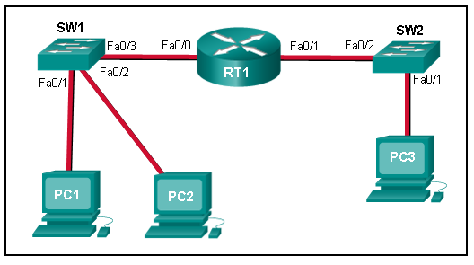
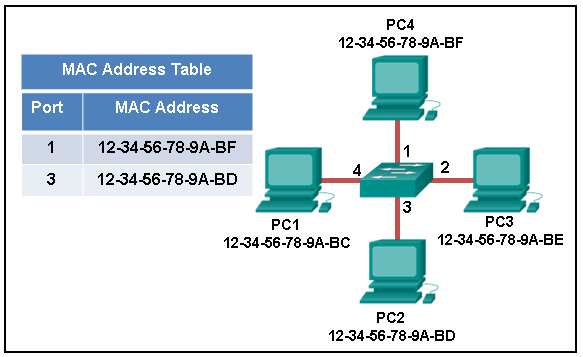
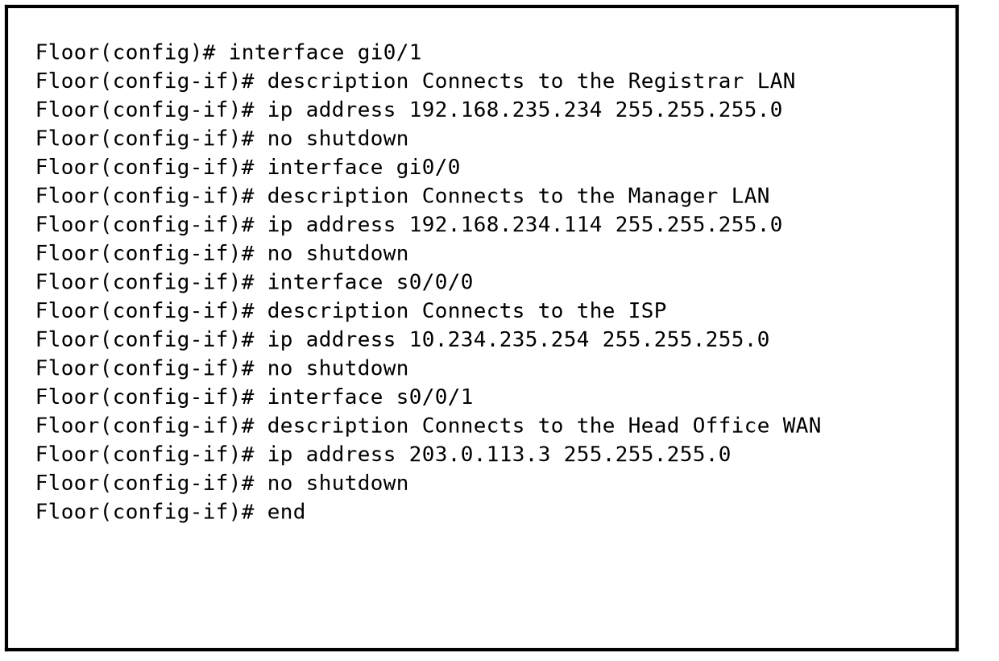

**Profesor:** Juan Manuel Campos Sandoval

---

# Resumen de resultados (Parte 1)

En la parte 1 de la evaluación diagnóstica CCNA Practice Final (ITN v7.0) se respondieron 20 reactivos (Preguntas 12 a 31), obteniendo 12 aciertos y 8 errores. Este documento desarrolla la revisión técnica de las 8 preguntas incorrectas conforme al material oficial de Cisco Networking Academy (*Introduction to Networks v7.0*), asociando a cada pregunta las secciones exactas del curso donde se localiza el contenido para su consulta y captura de pantalla.

| Reactivo | Tema evaluado | Módulos y temas de consulta en Cisco ITN | Estado |
| :--- | :--- | :--- | :---: |
| **Pregunta 15** | Acceso al medio y dúplex en conmutación | Módulo 6 (6.2.5, 6.2.7), Módulo 7 (7.1.3, 7.4.4) | Corregido |
| **Pregunta 17** | Topologías LAN físicas e híbridas | Módulo 6 (6.2.4), Módulo 1 (1.3.2) | Corregido |
| **Pregunta 18** | Procesamiento y desencapsulación de tramas | Módulo 6 (6.1.3), Módulo 3 (3.6.5), Módulo 8 (8.5.1) | Corregido |
| **Pregunta 21** | Rutas remotas y salto siguiente en tabla IP | Módulo 8 (8.5.2, 8.5.6, 8.5.5) | Corregido |
| **Pregunta 22** | Campos de dirección en el encabezado IPv4 | Módulo 8 (8.2.1, 8.2.2) | Corregido |
| **Pregunta 23** | Solicitud ARP hacia redes remotas | Módulo 9 (9.2.2, 9.2.4, 9.2.5), Módulo 3 (3.7.7) | Corregido |
| **Pregunta 25** | Tabla MAC y reenvío de unicast desconocido | Módulo 7 (7.3.1, 7.3.2, 7.3.3) | Corregido |
| **Pregunta 28** | Puerta de enlace predeterminada en LAN | Módulo 10 (10.3.1, 10.2.1), Módulo 8 (8.4.2, 8.4.3) | Corregido |

---

# 1. Pregunta 15: Control de acceso CSMA/CD y switches de Capa 2

### Enunciado y opciones

> **Pregunta 15:** Although CSMA/CD is still a feature of Ethernet, why is it no longer necessary?
>
> * **the use of full duplex capable Layer 2 switches (Respuesta correcta)**
> * the use of CSMA/CA
> * the development of half duplex switch operation
> * the virtually unlimited availability of IPv6 addresses
> * the use of Gigabit Ethernet speeds

### Explicación y fundamento técnico

* **Ubicación exacta en Cisco ITN:**
  * Módulo 6 (*Data Link Layer*): Tema 6.2.5 (*Half and Full Duplex Communication*) y Tema 6.2.7 (*Contention Based Access - CSMA/CD*).
  * Módulo 7 (*Ethernet Switching*): Tema 7.1.3 (*MAC Sublayer*) y Tema 7.4.4 (*Duplex and Speed Settings*).

El protocolo CSMA/CD (*Carrier Sense Multiple Access with Collision Detection*) se diseñó para redes Ethernet antiguas que operaban en modo semidúplex sobre un medio compartido, como el cable coaxial en topología de bus o los concentradores (*hubs*) de Capa 1. Cuando varios nodos transmitían de forma simultánea por el mismo canal físico, las señales eléctricas se superponían y generaban una colisión. CSMA/CD detectaba esa colisión y aplicaba un temporizador de retroceso aleatorio (*backoff*) antes de reintentar el envío.

En las redes LAN actuales, los switches de Capa 2 aíslan cada puerto en su propio dominio de colisión independiente y operan en modo dúplex completo (*full duplex*). En una conexión de dúplex completo entre una tarjeta de red (NIC) y el puerto del switch existen circuitos separados para transmitir (TX) y recibir (RX) al mismo tiempo. Al no existir contienda por un canal compartido entre el host y el switch, las colisiones físicas dejan de ocurrir y el algoritmo CSMA/CD no necesita activarse.

Las demás opciones se descartan por los siguientes motivos:

1. CSMA/CA es el método de prevención de colisiones empleado en redes inalámbricas IEEE 802.11 (WLAN), no el reemplazo de CSMA/CD en enlaces Ethernet cableados.
2. La operación en semidúplex (*half duplex*) mantiene la restricción de transmitir o recibir en un solo sentido a la vez, por lo que seguiría requiriendo CSMA/CD.
3. El espacio de direcciones IPv6 opera en la Capa 3 y no modifica el control de acceso al medio físico en la Capa 2.
4. El aumento de velocidad a Gigabit Ethernet por sí solo no elimina las colisiones si el enlace opera en semidúplex; el factor determinante es la comunicación en dúplex completo en los switches de Capa 2.

---

# 2. Pregunta 17: Topologías físicas híbridas en redes LAN

### Enunciado y opciones

> **Pregunta 17:** A network team is comparing topologies for connecting on a shared media. Which physical topology is an example of a hybrid topology for a LAN?
>
> * ring
> * **extended star (Respuesta correcta)**
> * bus
> * partial mesh

### Explicación y fundamento técnico

* **Ubicación exacta en Cisco ITN:**
  * Módulo 6 (*Data Link Layer*): Tema 6.2.4 (*LAN Topologies*).
  * Módulo 1 (*Networking Today*): Tema 1.3.2 (*Topology Diagrams*).

Las topologías físicas de una red de área local (LAN) definen cómo se interconectan físicamente los dispositivos finales e intermedios:

* **Estrella (*Star*):** Los dispositivos finales se conectan a un dispositivo intermedio central, típicamente un switch Ethernet.
* **Estrella extendida (*Extended Star*):** Interconecta múltiples topologías en estrella mediante enlaces troncales o un switch central jerárquico, formando una topología híbrida que permite escalar la cobertura física de la red LAN en edificios o campus.
* **Bus:** Todos los nodos se conectan de forma secuencial a lo largo de un mismo cable troncal compartido.
* **Anillo (*Ring*):** Cada nodo se conecta exactamente con 2 nodos vecinos formando un circuito cerrado.

La topología en estrella extendida se clasifica como una topología híbrida para redes LAN porque combina múltiples segmentos en estrella bajo una jerarquía interconectada. Por su parte, las topologías de bus y anillo son topologías básicas tradicionales, mientras que la malla parcial (*partial mesh*) corresponde a una topología de red de área amplia (WAN) utilizada para interconectar routers entre sitios remotos con rutas redundantes.

---

# 3. Pregunta 18: Procesamiento de tramas de Capa 2 en el router

### Enunciado y opciones

> **Pregunta 18:** What does a router do when it receives a Layer 2 frame over the network medium?
>
> * forwards the new frame appropriate to the medium of that segment of the physical network
> * **de-encapsulates the frame (Respuesta correcta)**
> * determines the best path
> * re-encapsulates the packet into a new frame

### Explicación y fundamento técnico

* **Ubicación exacta en Cisco ITN:**
  * Módulo 6 (*Data Link Layer*): Tema 6.1.3 (*Providing Access to Media*).
  * Módulo 3 (*Protocols and Models*): Tema 3.6.5 (*De-encapsulation Example*).
  * Módulo 8 (*Network Layer*): Tema 8.5.1 (*Router Packet Forwarding Decision*).

Cuando un router recibe una trama a través de una de sus interfaces de red, ejecuta una secuencia ordenada de 4 etapas para trasladar el paquete entre enlaces:

1. Recibe la trama de Capa 2 desde el medio físico y verifica el campo FCS (*Frame Check Sequence*); si la trama es válida, desencapsula la trama eliminando el encabezado y el tráiler de enlace de datos para extraer el paquete de Capa 3.
2. Examina la dirección IP de destino del paquete y consulta su tabla de enrutamiento para determinar la mejor ruta y la interfaz de salida hacia el siguiente salto.
3. Reencapsula el paquete de Capa 3 dentro de una nueva trama de Capa 2 acorde al protocolo de enlace de la interfaz de salida.
4. Transmite la nueva trama hacia el medio físico de ese segmento de red.

La pregunta solicita específicamente la acción inmediata que realiza el router al recibir la trama de Capa 2 desde el medio (*when it receives a Layer 2 frame over the network medium*). Esa acción inicial es desencapsular la trama (*deencapsulate the frame*). La determinación de la ruta, la reencapsulación y el reenvío ocurren en pasos posteriores una vez que el paquete IP ya fue extraído.

---

# 4. Pregunta 21: Entradas de rutas remotas en la tabla de enrutamiento

### Enunciado y opciones

> **Pregunta 21:** What routing table entry has a next hop address associated with a destination network?
>
> * C and L source routes
> * local routes
> * **remote routes (Respuesta correcta)**
> * directly connected routes

### Explicación y fundamento técnico

* **Ubicación exacta en Cisco ITN:**
  * Módulo 8 (*Network Layer*): Tema 8.5.2 (*IP Router Routing Table*).
  * Módulo 8 (*Network Layer*): Tema 8.5.5 (*Video - IPv4 Router Routing Tables*).
  * Módulo 8 (*Network Layer*): Tema 8.5.6 (*Introduction to an IPv4 Routing Table*).

La tabla de enrutamiento de un router Cisco IOS almacena 3 categorías principales de entradas según la relación del router con la red de destino:

| Tipo de entrada | Códigos en IOS | Asociación en la tabla de enrutamiento |
| :--- | :---: | :--- |
| **Red conectada directamente** | `C` | Asociada únicamente a la interfaz física o virtual local del router (`is directly connected, GigabitEthernet0/0/0`). No tiene dirección IP de siguiente salto. |
| **Ruta de interfaz local** | `L` | Prefijo `/32` en IPv4 o `/128` en IPv6 que representa la dirección IP exacta asignada a la interfaz del propio router. Tampoco utiliza siguiente salto. |
| **Ruta remota** | `S`, `O`, `D`, `R`, `B` | Red que no está conectada de forma directa al router. Para alcanzarla, la entrada especifica la dirección IP del siguiente salto (`via <next-hop-IP>`) correspondiente al router vecino. |

Únicamente las rutas remotas (*remote routes*), ya sean configuradas como rutas estáticas (`S`) o aprendidas mediante protocolos de enrutamiento dinámico como OSPF (`O`) o EIGRP (`D`), incluyen una dirección IP de siguiente salto (*next hop address*) asociada a la red de destino.

---

# 5. Pregunta 22: Campos de direccionamiento en el encabezado IPv4

### Enunciado y opciones

> **Pregunta 22:** Which term describes a field in the IPv4 packet header that contains a unicast, multicast, or broadcast address?
>
> * header checksum
> * protocol
> * TTL
> * **destination IPv4 address (Respuesta correcta)**

### Explicación y fundamento técnico

* **Ubicación exacta en Cisco ITN:**
  * Módulo 8 (*Network Layer*): Tema 8.2.1 (*IPv4 Packet Header*).
  * Módulo 8 (*Network Layer*): Tema 8.2.2 (*IPv4 Packet Header Fields*).

El encabezado de un paquete IPv4 contiene campos de control y 2 campos de direccionamiento de 32 bits:

* **Dirección IPv4 de origen (*Source IPv4 Address*):** Identifica al nodo emisor del paquete; por regla del protocolo IPv4, el origen siempre es una dirección unicast individual.
* **Dirección IPv4 de destino (*Destination IPv4 Address*):** Identifica al receptor o grupo de receptores del paquete. Este campo puede contener una dirección unicast (un host específico), una dirección multicast en el rango `224.0.0.0` a `239.255.255.255` (un grupo de hosts suscritos) o una dirección de broadcast (`255.255.255.255` o el broadcast dirigido de una subred).
* **TTL (*Time to Live*):** Contador binario de 8 bits que limita la vida útil del paquete decrementándose en 1 en cada salto de router.
* **Protocol:** Campo de 8 bits que identifica el protocolo de Capa 4 encapsulado (por ejemplo, `6` para TCP, `17` para UDP o `1` para ICMP).
* **Header Checksum:** Valor de 16 bits utilizado para verificar la integridad del propio encabezado IPv4.

Por lo tanto, el campo que puede almacenar una dirección unicast, multicast o broadcast dentro del encabezado es la dirección IPv4 de destino (*destination IPv4 address*).

---

# 6. Pregunta 23: Operación de ARP hacia una red remota

### Enunciado y opciones

> **Pregunta 23:** Refer to the exhibit. PC1 issues an ARP request because it needs to send a packet to PC3. In this scenario, what will happen next?
>
> * RT1 will send an ARP reply with the PC3 MAC address.
> * **RT1 will send an ARP reply with its own Fa0/0 MAC address. (Respuesta correcta)**
> * RT1 will forward the ARP request to PC3.
> * SW1 will send an ARP reply with its Fa0/1 MAC address.

{ width=68% }

### Explicación y fundamento técnico

* **Ubicación exacta en Cisco ITN:**
  * Módulo 9 (*Address Resolution*): Tema 9.2.2 (*ARP Functions*).
  * Módulo 9 (*Address Resolution*): Tema 9.2.4 (*Video - ARP Operation - ARP Reply*).
  * Módulo 9 (*Address Resolution*): Tema 9.2.5 (*Video - ARP Role in Remote Communications*).
  * Módulo 3 (*Protocols and Models*): Tema 3.7.7 (*Role of the Data Link Layer Addresses - Different IP Networks*).

En la topología mostrada en la imagen, `PC1` y `PC2` pertenecen a la red LAN conectada a la interfaz `Fa0/0` del router `RT1` a través del switch `SW1`, mientras que `PC3` se encuentra en una red LAN distinta conectada a la interfaz `Fa0/1` de `RT1` a través de `SW2`.

Cuando un host necesita enviar un paquete IPv4 a otro dispositivo, antes de transmitir compara la dirección IP de destino con su propia dirección IP y máscara de subred:

1. Como `PC3` está en una subred remota diferente a la de `PC1`, `PC1` determina que no puede entregar la trama directamente a `PC3` en la Capa 2 y que debe enviar el paquete a su puerta de enlace predeterminada (*default gateway*), que es la interfaz `Fa0/0` del router `RT1`.
2. Para encapsular la trama Ethernet hacia el router, `PC1` busca en su tabla ARP la dirección MAC asociada a la dirección IP de `RT1` (`Fa0/0`). Si no la tiene en caché, `PC1` emite una solicitud ARP (*ARP request*) en broadcast consultando la dirección MAC de la interfaz `Fa0/0` de `RT1`.
3. El router `RT1` recibe esa solicitud ARP en `Fa0/0` y responde con un mensaje ARP reply unicast que contiene su propia dirección MAC de la interfaz `Fa0/0`.

Los routers no reenvían solicitudes ARP en broadcast hacia otras interfaces porque delimitan los dominios de broadcast de Capa 2, y los switches de Capa 2 como `SW1` solo reenvían la trama en la LAN sin responder solicitudes ARP dirigidas a la puerta de enlace.

---

# 7. Pregunta 25: Comportamiento de inundación de tramas en un switch

### Enunciado y opciones

> **Pregunta 25:** Refer to the exhibit. The exhibit shows a small switched network and the contents of the MAC address table of the switch. PC1 has sent a frame addressed to PC3. What will the switch do with the frame?
>
> * The switch will forward the frame only to ports 1 and 3.
> * The switch will forward the frame only to port 2.
> * The switch will discard the frame.
> * The switch will forward the frame to all ports.
> * **The switch will forward the frame to all ports except port 4. (Respuesta correcta)**

{ width=72% }

### Explicación y fundamento técnico

* **Ubicación exacta en Cisco ITN:**
  * Módulo 7 (*Ethernet Switching*): Tema 7.3.1 (*Switch Fundamentals*).
  * Módulo 7 (*Ethernet Switching*): Tema 7.3.2 (*Switch Learning and Forwarding*).
  * Módulo 7 (*Ethernet Switching*): Tema 7.3.3 (*Filtering Frames*).

La imagen muestra un switch con 4 dispositivos conectados:

* Puerto 1: `PC4` con MAC `12-34-56-78-9A-BF` (registrada en la tabla MAC).
* Puerto 2: `PC3` con MAC `12-34-56-78-9A-BE` (no figura en la tabla MAC).
* Puerto 3: `PC2` con MAC `12-34-56-78-9A-BD` (registrada en la tabla MAC).
* Puerto 4: `PC1` con MAC `12-34-56-78-9A-BC` (no figura aún en la tabla MAC).

Cuando `PC1` (conectada al puerto 4) envía una trama dirigida a `PC3` (`12-34-56-78-9A-BE`), el switch realiza 2 operaciones:

1. Aprendizaje de dirección de origen: registra en su tabla MAC la dirección de origen `12-34-56-78-9A-BC` asociada al puerto de entrada 4.
2. Búsqueda de dirección de destino: inspecciona la dirección MAC de destino `12-34-56-78-9A-BE` en su tabla MAC. Como la tabla actual solo contiene entradas para los puertos 1 (`12-34-56-78-9A-BF`) y 3 (`12-34-56-78-9A-BD`), la dirección MAC de `PC3` es una dirección unicast desconocida (*unknown unicast*).

Ante una trama unicast desconocida, el switch inunda (*floods*) la trama enviándola por todos los puertos activos excepto por el puerto por el cual ingresó la trama (puerto 4). De esta manera la trama sale por los puertos 1, 2 y 3, garantizando que `PC3` (en el puerto 2) la reciba aunque el switch aún no hubiera aprendido su ubicación.

---

# 8. Pregunta 28: Selección de puerta de enlace predeterminada según configuración de interfaz

### Enunciado y opciones

> **Pregunta 28:** Refer to the exhibit. A network administrator is connecting a new host to the Registrar LAN. The host needs to communicate with remote networks. What IP address would be configured as the default gateway on the new host?
>
> * 203.0.113.3
> * 10.234.235.254
> * 192.168.235.1
> * 192.168.234.114
> * **192.168.235.234 (Respuesta correcta)**

{ width=78% }

### Explicación y fundamento técnico

* **Ubicación exacta en Cisco ITN:**
  * Módulo 10 (*Basic Router Configuration*): Tema 10.3.1 (*Default Gateway on a Host*) y Tema 10.2.1 (*Configure Router Interfaces*).
  * Módulo 8 (*Network Layer*): Tema 8.4.2 (*Default Gateway*) y Tema 8.4.3 (*A Host Routes to the Default Gateway*).

La puerta de enlace predeterminada (*default gateway*) configurada en cualquier host debe ser la dirección IP asignada a la interfaz del router que está conectada directamente a la misma red local (LAN) de ese host. Analizando las 4 interfaces configuradas en el router `Floor`:

| Interfaz del router | Descripción configurada (`description`) | Dirección IP y máscara | Función en la red |
| :--- | :--- | :--- | :--- |
| `GigabitEthernet0/1` | `Connects to the Registrar LAN` | `192.168.235.234 /24` | Puerta de enlace de la LAN Registrar |
| `GigabitEthernet0/0` | `Connects to the Manager LAN` | `192.168.234.114 /24` | Puerta de enlace de la LAN Manager |
| `Serial0/0/0` | `Connects to the ISP` | `10.234.235.254 /24` | Enlace serial WAN hacia el proveedor ISP |
| `Serial0/0/1` | `Connects to the Head Office WAN` | `203.0.113.3 /24` | Enlace serial WAN hacia la oficina central |

Dado que el nuevo host se conecta a la red `Registrar LAN`, su puerta de enlace predeterminada debe ser la dirección IP de la interfaz `gi0/1` del router `Floor`, la cual tiene la descripción `Connects to the Registrar LAN` y la dirección IP `192.168.235.234`. La opción `192.168.235.1` es un distractor común que asume por costumbre el host `.1` de la subred, pero en esta configuración real el administrador asignó `.234` a la interfaz del router.
