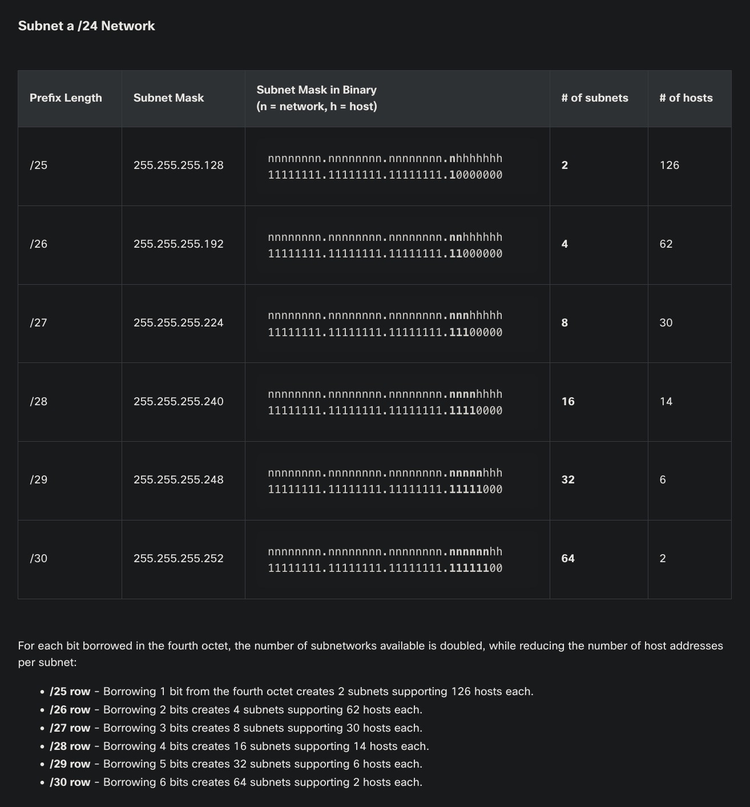
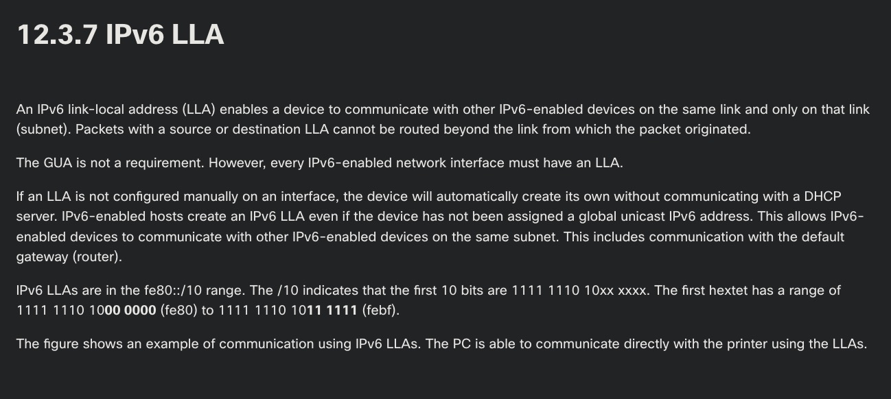
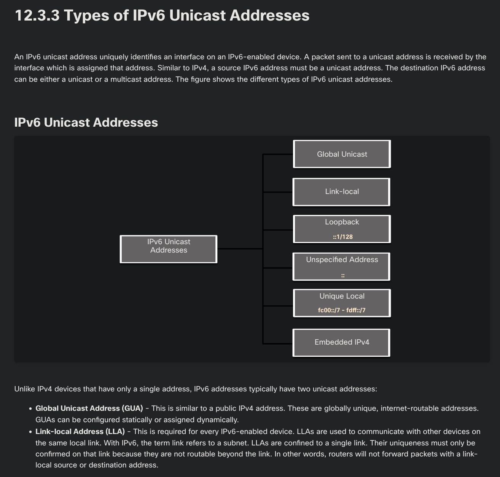
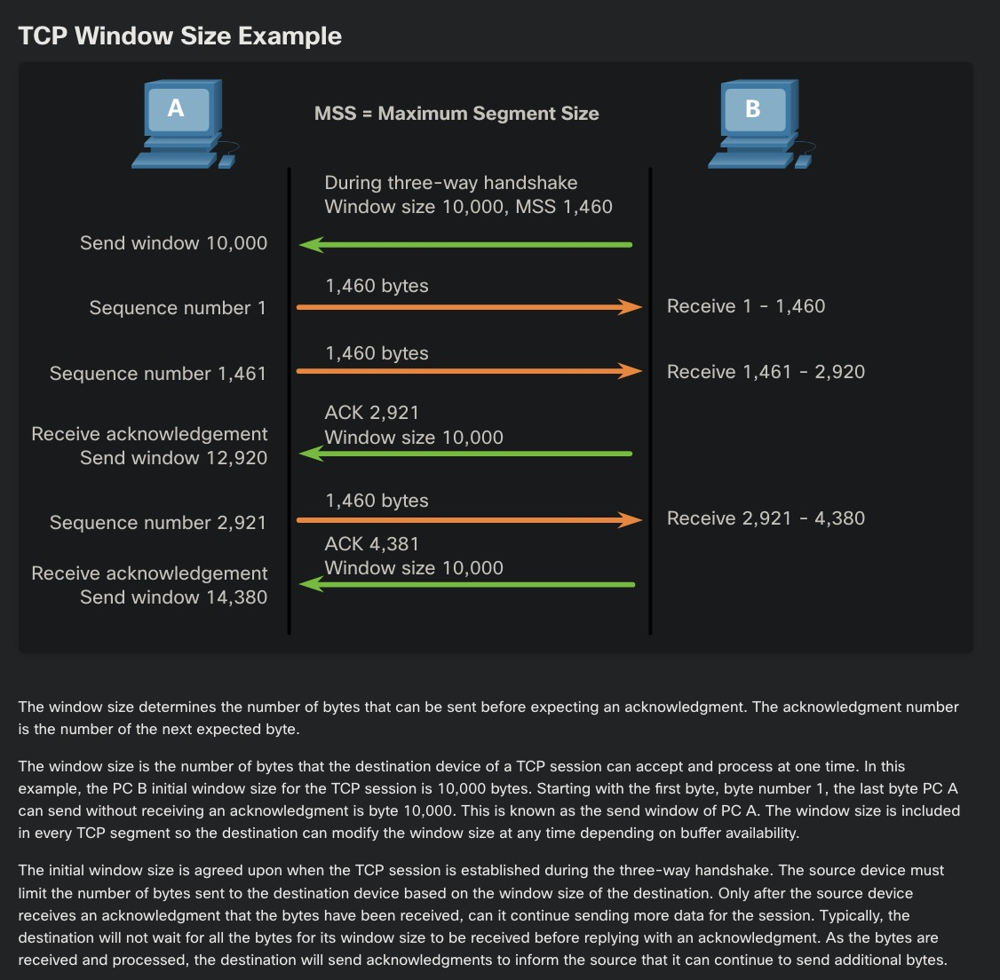
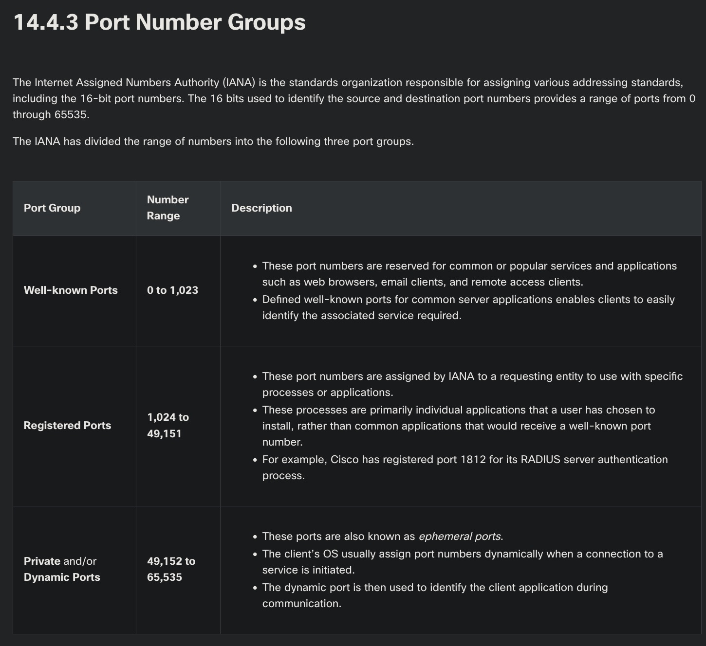
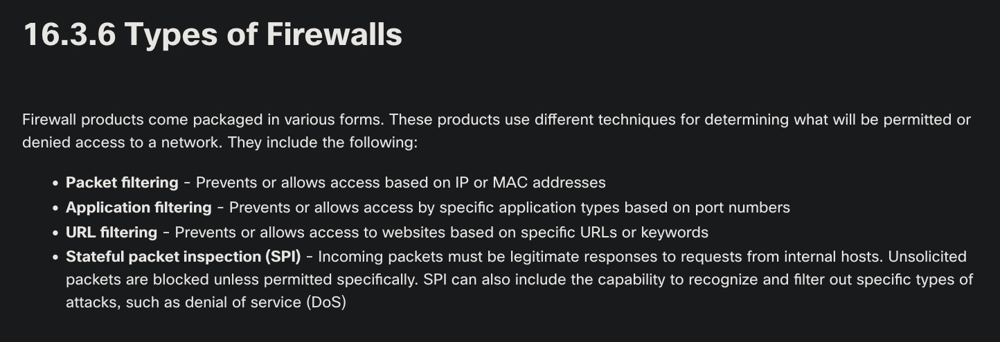
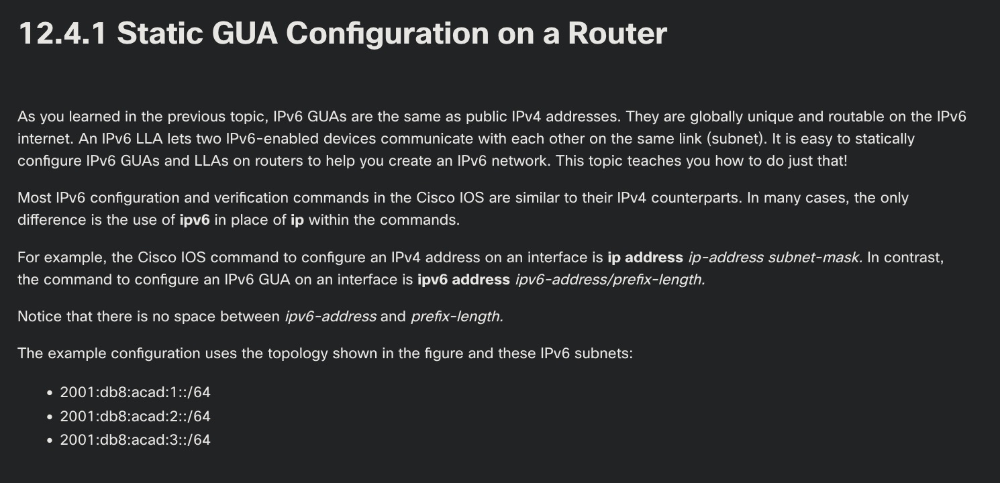
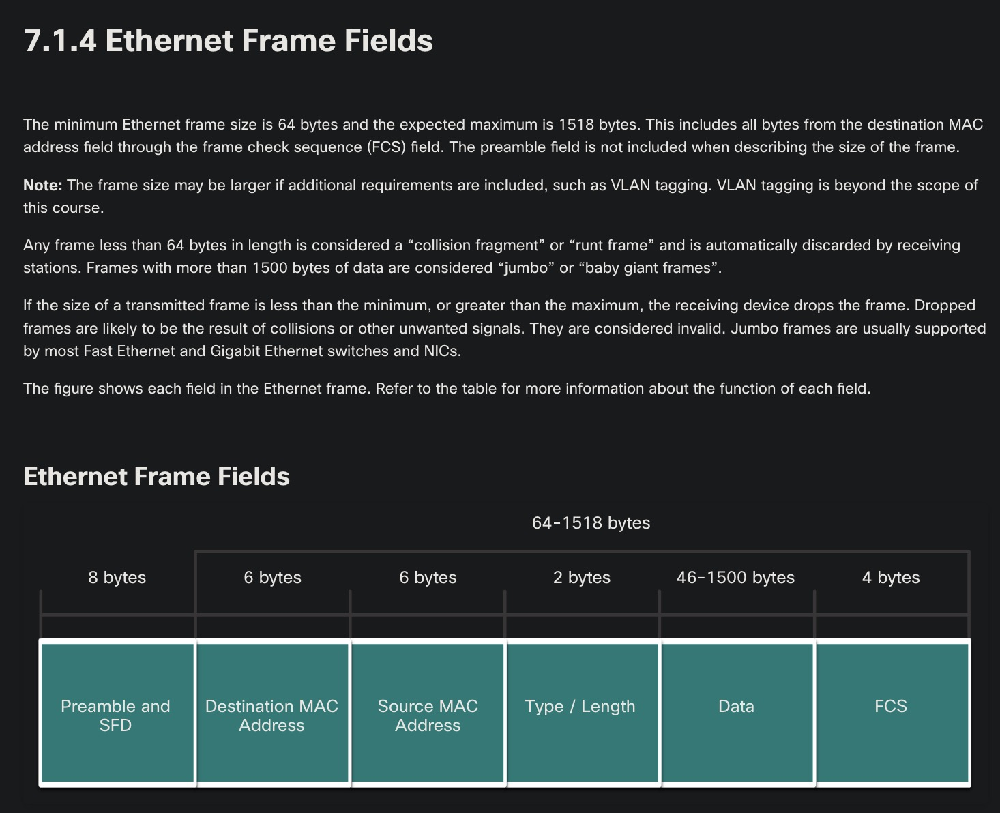
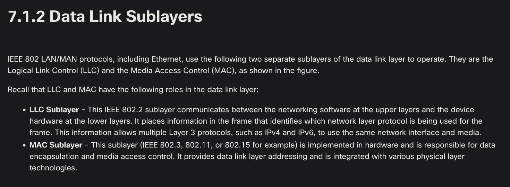

Profesor: Juan Manuel Campos Sandoval

---

1. Three devices are on three different subnets. Match the network address and the broadcast address with each subnet where these devices are located. Device 1: IP address 192.168.10.77/28 on subnet 1. Device 2: IP address 192.168.10.17/30 on subnet 2. Device 3: IP address 192.168.10.35/29 on subnet 3.
    - Respuesta: Subnet 1 network number -> 192.168.10.64
    - Respuesta: Subnet 1 broadcast address -> 192.168.10.79
    - Respuesta: Subnet 2 network number -> 192.168.10.16
    - Respuesta: Subnet 2 broadcast address -> 192.168.10.19
    - Respuesta: Subnet 3 network number -> 192.168.10.32
    - Respuesta: Subnet 3 broadcast address -> 192.168.10.39
    - La máscara /28 crea bloques de 16 direcciones, /30 bloques de 4 direcciones y /29 bloques de 8 direcciones en el cuarto octeto.

2. Given network 172.18.109.0, which subnet mask would be used if 6 host bits were available?
    - Respuesta: 255.255.255.192
    - Reservar 6 bits de host en el cuarto octeto deja 2 bits para subred, lo que produce la máscara /26 equivalente a 255.255.255.192.

3. Refer to the exhibit. A user issues the command netstat -r on a workstation. Which IPv6 address is one of the link-local addresses of the workstation?
    - Respuesta: fe80::30d0:115:3f57:fe4c/128
    - Las direcciones link local de IPv6 inician obligatoriamente con el prefijo fe80::/10 y operan en el enlace local de la interfaz.

4. What type of IPv6 address is represented by ::1/128?
    - Respuesta: loopback
    - La dirección ::1/128 está reservada exclusivamente para pruebas internas de loopback dentro de la pila TCP/IP del host.

5. Refer to the exhibit. What does the value of the window size specify?
    - Respuesta: the amount of data that can be sent before an acknowledgment is required
    - La ventana de TCP establece el volumen de bytes que el emisor puede transmitir antes de requerir una confirmación del receptor.

6. To which TCP port group does the port 414 belong?
    - Respuesta: well-known
    - La IANA reserva el rango de puertos del 0 al 1023 para servicios universales bajo la clasificación de puertos conocidos.

7. Which statement describes the characteristics of packet-filtering and stateful firewalls as they relate to the OSI model?
    - Respuesta: A packet-filtering firewall typically can filter up to the transport layer, whereas a stateful firewall can filter up to the session layer.
    - El filtrado de paquetes analiza cabeceras hasta Capa 4 de transporte, mientras que un firewall con estado rastrea conexiones activas hasta Capa 5 de sesión.

8. Only employees connected to IPv6 interfaces are having difficulty connecting to remote networks. The analyst wants to verify that IPv6 routing has been enabled. What is the best command to use to accomplish the task?
    - Respuesta: show running-config
    - El comando show running-config confirma si la instrucción global ipv6 unicast-routing forma parte de la configuración activa del router.

9. What happens when a switch receives a frame and the calculated CRC value is different than the value that is in the FCS field?
    - Respuesta: The switch drops the frame.
    - Si el cálculo de CRC difiere del campo FCS, el switch detecta datos corruptos y descarta la trama de inmediato.

10. Which two issues can cause both runts and giants in Ethernet networks? (Choose two.)
    - Respuesta: a malfunctioning NIC
    - Respuesta: half-duplex operations
    - Las colisiones recurrentes en modo semidúplex generan fragmentos de trama menores a 64 bytes.
    - Una tarjeta de red defectuosa puede transmitir tramas dañadas que superan los 1518 bytes.

11. Which two functions are performed at the LLC sublayer of the OSI Data Link Layer to facilitate Ethernet communication? (Choose two.)
    - Respuesta: places information in the Ethernet frame that identifies which network layer protocol is being encapsulated by the frame
    - Respuesta: adds Ethernet control information to network protocol data
    - La subcapa LLC inserta información de control e identifica el protocolo de red de Capa 3 encapsulado dentro de la trama Ethernet.

---

Anexo: Capturas del material de Cisco Introduction to Networks

{ width=48% } { width=48% }

{ width=48% } { width=48% }

{ width=48% } { width=48% }

{ width=48% } { width=48% }

{ width=48% }
