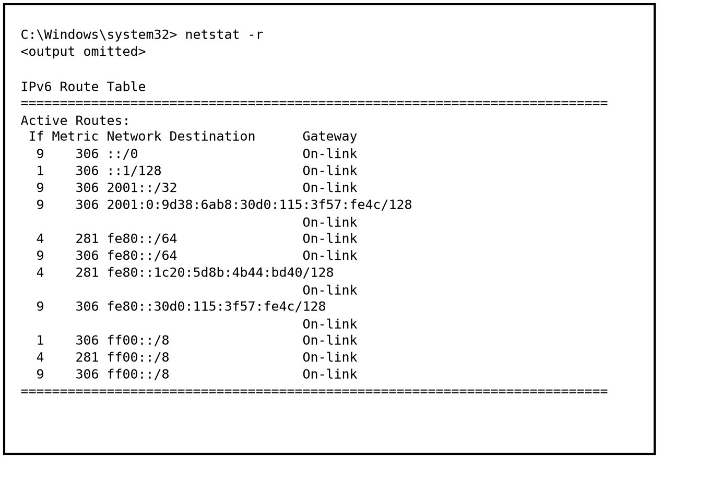
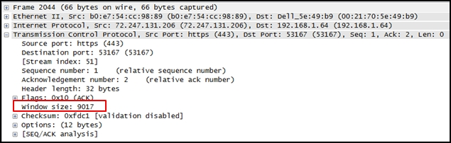

**Profesor:** Juan Manuel Campos Sandoval

---

# Resumen de resultados (Parte 2)

En la parte 2 de la evaluación diagnóstica CCNA Practice Final (ITN v7.0) se respondieron 21 reactivos (Preguntas 30 a 50 y reactivos complementarios hasta la Pregunta 53), obteniendo 13 aciertos y 8 errores. Este documento desarrolla la revisión técnica de las 8 preguntas incorrectas conforme al currículo oficial de Cisco Networking Academy (*Introduction to Networks v7.0*), incluyendo el cálculo binario paso a paso de máscara de subred, el análisis de capturas y salidas de terminal, y el fundamento de cada respuesta.

| Reactivo | Tema del currículo Cisco ITN v7.0 | Módulo | Estado |
| :--- | :--- | :---: | :---: |
| **Pregunta 32** | Cálculo de máscara de subred IPv4 según bits de host | Módulo 11 (11.5.2) | Corregido |
| **Pregunta 33** | Identificación de direcciones IPv6 link local en `netstat` | Módulo 12 (12.3.7) | Corregido |
| **Pregunta 35** | Dirección IPv6 de loopback (`::1/128`) | Módulo 12 (12.3.3) | Corregido |
| **Pregunta 39** | Control de flujo y tamaño de ventana (*Window Size*) en TCP | Módulo 14 (14.6.5) | Corregido |
| **Pregunta 41** | Clasificación de rangos de puertos TCP y UDP (IANA) | Módulo 14 (14.4.3) | Corregido |
| **Pregunta 47** | Firewalls de filtrado de paquetes y stateful en el modelo OSI | Módulo 16 (16.3.6) | Corregido |
| **Pregunta 51** | Verificación de enrutamiento IPv6 mediante `show running-config` | Módulo 12 (12.5.1) | Corregido |
| **Pregunta 52** | Detección de errores CRC en el campo FCS de tramas Ethernet | Módulo 7 (7.1.4) | Corregido |

---

# 1. Pregunta 32: Cálculo de máscara de subred IPv4 con 6 bits de host

### Enunciado y opciones

> **Pregunta 32:** Given network 172.18.109.0, which subnet mask would be used if 6 host bits were available?
>
> * **255.255.255.192 (Respuesta correcta)**
> * 255.255.224.0
> * 255.255.255.252
> * 255.255.255.248
> * 255.255.192.0

### Procedimiento de cálculo paso a paso (Módulo 11: IPv4 Addressing, Tema 11.5.2)

Una dirección IPv4 y su máscara de subred tienen una longitud total de $32\text{ bits}$ divididos en 4 octetos de $8\text{ bits}$ cada uno. La relación entre los bits destinados al prefijo de red ($n$) y los bits reservados para identificar hosts ($h$) cumple la identidad:

$$n + h = 32$$

1. Cálculo de la longitud de prefijo ($n$): si se dispone exactamente de $h = 6\text{ bits}$ para la porción de host (ubicados en los bits menos significativos a la derecha del octeto 4), el número de bits en `1` correspondientes a la máscara de red es:
   $$n = 32 - 6 = 26\text{ bits} \implies /26$$
2. Representación binaria de los 4 octetos de la máscara `/26`: los 3 octetos iniciales completan $3 \times 8 = 24\text{ bits}$ en `1`, y los $2\text{ bits}$ de red restantes ($26 - 24 = 2$) se colocan al inicio del octeto 4 seguidos de los $6\text{ bits}$ de host en `0`:
   $$\underbrace{11111111}_{255}\,.\,\underbrace{11111111}_{255}\,.\,\underbrace{11111111}_{255}\,.\,\underbrace{\mathbf{11}}_{\text{red}}\underbrace{000000}_{6\text{ bits host}}$$
3. Conversión ponderada del octeto 4 a decimal: sumando los valores posicionales de los 8 bits del octeto 4:

| Valor posicional ($2^k$) | $128$ | $64$ | $32$ | $16$ | $8$ | $4$ | $2$ | $1$ |
| :--- | :---: | :---: | :---: | :---: | :---: | :---: | :---: | :---: |
| **Bit en la máscara `/26`** | `1` | `1` | `0` | `0` | `0` | `0` | `0` | `0` |
| **Aporte decimal** | $128$ | $+64$ | $0$ | $0$ | $0$ | $0$ | $0$ | $0$ |

   $$\text{Octeto } 4 = 128 + 64 = 192$$

4. Capacidad y estructura de la subred resultante: con la máscara decimal `255.255.255.192` (`/26`), el salto de bloque en el octeto 4 es $256 - 192 = 64$, generando una capacidad de:
   $$\text{Hosts utilizables por subred} = 2^6 - 2 = 64 - 2 = 62\text{ hosts}$$
   Para la subred base `172.18.109.0/26`, el rango utilizable abarca desde `172.18.109.1` hasta `172.18.109.62`, con dirección de broadcast en `172.18.109.63`.

Las demás opciones corresponden a cantidades distintas de bits de host: `255.255.255.252` (`/30`) deja solo $2\text{ bits}$ de host, `255.255.255.248` (`/29`) deja $3\text{ bits}$ de host, `255.255.224.0` (`/19`) deja $13\text{ bits}$ de host y `255.255.192.0` (`/18`) deja $14\text{ bits}$ de host.

---

# 2. Pregunta 33: Identificación de direcciones IPv6 link local en `netstat -r`

### Enunciado y opciones

> **Pregunta 33:** Refer to the exhibit. A user issues the command netstat -r on a workstation. Which IPv6 address is one of the link-local addresses of the workstation?
>
> * **fe80::30d0:115:3f57:fe4c/128 (Respuesta correcta)**
> * ::1/128
> * fe80::/64
> * 2001:0:9d38:6ab8:30d0:115:3f57:fe4c/128

{ width=80% }

### Explicación y fundamento técnico (Módulo 12: IPv6 Addressing, Tema 12.3.7)

En la tabla de enrutamiento IPv6 generada por el comando `netstat -r` en Windows, cada fila indica el tipo de destino según su prefijo y su longitud de máscara:

| Entrada en `netstat -r` | Prefijo | Significado en la tabla |
| --- | --- | --- |
| `::/0` | `/0` | Ruta predeterminada IPv6. |
| `::1/128` | `/128` | Dirección de loopback local del host. |
| `2001::/32` y `2001:0:9d38:...` | `/32`, `/128` | Red y dirección unicast global (GUA) / túnel Teredo. |
| `fe80::/64` | `/64` | Prefijo de red del enlace local (no es dirección de host). |
| `fe80::1c20:5d8b:4b44:bd40/128` | `/128` | Dirección link local asignada a la interfaz 4 del equipo. |
| `fe80::30d0:115:3f57:fe4c/128` | `/128` | Dirección link local asignada a la interfaz 9 del equipo. |
| `ff00::/8` | `/8` | Rango reservado para direcciones multicast IPv6. |

Las direcciones IPv6 de enlace local (*link local*) pertenecen al bloque `fe80::/10` (usualmente representadas bajo el prefijo `fe80::/64`). Sin embargo, en la salida de `netstat -r`, la entrada `fe80::/64` representa a la subred completa del enlace local, mientras que las entradas con prefijo `/128` indican las direcciones exactas de $128\text{ bits}$ configuradas en las interfaces del equipo local. Por ello, `fe80::30d0:115:3f57:fe4c/128` es la dirección link local de la estación de trabajo entre las opciones disponibles.

---

# 3. Pregunta 35: Dirección IPv6 de loopback (`::1/128`)

### Enunciado y opciones

> **Pregunta 35:** What type of IPv6 address is represented by ::1/128?
>
> * **loopback (Respuesta correcta)**
> * unspecified
> * EUI-64 generated link-local
> * global unicast

### Explicación y fundamento técnico (Módulo 12: IPv6 Addressing, Tema 12.3.3)

En la arquitectura de direccionamiento IPv6 existen direcciones unicast especiales con propósitos reservados por el estándar RFC 4291:

* **Dirección de loopback (`::1/128`):** Equivale a `0000:0000:0000:0000:0000:0000:0000:0001` en su representación extendida de 128 bits. Al comprimir los 7 hextetos iniciales de ceros mediante el símbolo `::` y omitir los ceros a la izquierda del hexteto 8, se escribe `::1/128`. Un host la utiliza para enviarse paquetes a sí mismo y verificar que la pila de protocolos TCP/IPv6 local esté operativa (cumple la misma función que `127.0.0.1` en IPv4).
* **Dirección sin especificar (*Unspecified*, `::/128`):** Compuesta íntegramente por 128 ceros (`0:0:0:0:0:0:0:0`). Se emplea únicamente como dirección de origen provisional cuando un dispositivo aún no tiene dirección IPv6 asignada, por ejemplo durante el proceso DAD (*Duplicate Address Detection*).
* **Dirección link local generada por EUI 64:** Comienza siempre con el prefijo `fe80::` e inserta los bits hexadecimales `fffe` en el centro de la dirección MAC de 48 bits de la interfaz.
* **Dirección global unicast (GUA):** Dirección enrutable en Internet que actualmente inicia con los bits `001` (rango `2000::/3`).

---

# 4. Pregunta 39: Función del campo Window Size en el encabezado TCP

### Enunciado y opciones

> **Pregunta 39:** Refer to the exhibit. What does the value of the window size specify?
>
> * the total number of bits received during this TCP session
> * the amount of data that can be sent at one time
> * a random number that is used in establishing a connection with the 3-way handshake
> * **the amount of data that can be sent before an acknowledgment is required (Respuesta correcta)**

{ width=84% }

### Explicación y fundamento técnico (Módulo 14: Transport Layer, Tema 14.6.5)

En la captura de Wireshark se observa un segmento TCP cuyo encabezado resalta el campo `window size: 9017`. El tamaño de ventana (*window size*) es el mecanismo de control de flujo de la Capa 4 en TCP:

1. El valor del campo *Window Size* indica la cantidad de bytes de datos que el dispositivo emisor puede transmitir de forma continua antes de detenerse a esperar un acuse de recibo (*acknowledgment*, ACK) por parte del receptor.
2. Quien anuncia el tamaño de ventana es el receptor según el espacio libre disponible en su búfer de memoria entrante. En este caso, el host receptor informa que puede aceptar hasta $9017\text{ bytes}$ sin saturar sus búferes. Si el búfer del receptor empieza a llenarse, envía un segmento ACK reduciendo el valor de *Window Size*; cuando libera memoria, incrementa nuevamente la ventana deslizante.

Es importante no confundir el tamaño de ventana con el tamaño máximo de segmento (*Maximum Segment Size*, MSS), el cual sí limita la cantidad de datos útiles que viajan dentro de un segmento individual, ni con el número de secuencia inicial (ISN), que es el número pseudoaleatorio negociado durante el saludo de 3 vías (*three way handshake*).

---

# 5. Pregunta 41: Clasificación de grupos de puertos TCP/UDP según IANA

### Enunciado y opciones

> **Pregunta 41:** To which TCP port group does the port 414 belong?
>
> * **well-known (Respuesta correcta)**
> * private or dynamic
> * registered
> * public

### Explicación y fundamento técnico (Módulo 14: Transport Layer, Tema 14.4.3)

La autoridad de asignación de números de Internet (IANA, *Internet Assigned Numbers Authority*) divide los $65536$ puertos posibles de $16\text{ bits}$ ($0$ a $65535$) de los protocolos TCP y UDP en 3 grupos numéricos estrictos:

| Grupo de puertos (IANA) | Rango numérico | Uso principal |
| :--- | :---: | :--- |
| **Puertos bien conocidos (*Well Known Ports*)** | `0` a `1023` | Reservados para servicios y protocolos estándar de red (HTTP `80`, HTTPS `443`, SSH `22`, DNS `53`, SMTP `25`, etc.). |
| **Puertos registrados (*Registered Ports*)** | `1024` a `49151` | Asignados por IANA a entidades solicitantes para aplicaciones específicas de usuario o servidores empresariales (por ejemplo, Cisco RADIUS `1812`, MySQL `3306`, RDP `3389`). |
| **Puertos privados o dinámicos (*Private or Dynamic Ports*)** | `49152` a `65535` | Conocidos también como puertos efímeros; el sistema operativo del cliente los asigna de forma temporal como puertos de origen al iniciar una sesión. |

Como el número `414` se cumple dentro del intervalo $0 \le 414 \le 1023$, pertenece al grupo de puertos bien conocidos (*well known ports*). La opción *public* no es una categoría oficial definida por IANA.

---

# 6. Pregunta 47: Firewalls de filtrado de paquetes frente a firewalls stateful en el modelo OSI

### Enunciado y opciones

> **Pregunta 47:** Which statement describes the characteristics of packet-filtering and stateful firewalls as they relate to the OSI model?
>
> * A packet-filtering firewall uses session layer information to track the state of a connection, whereas a stateful firewall uses application layer information to track the state of a connection.
> * A stateful firewall can filter application layer information, whereas a packet-filtering firewall cannot filter beyond the network layer.
> * Both stateful and packet-filtering firewalls can filter at the application layer.
> * **A packet-filtering firewall typically can filter up to the transport layer, whereas a stateful firewall can filter up to the session layer. (Respuesta correcta)**

### Explicación y fundamento técnico (Módulo 16: Network Security Fundamentals, Tema 16.3.6)

En el currículo de Cisco ITN v7.0, los firewalls se clasifican según las capas del modelo OSI que inspeccionan al tomar decisiones de permitido o denegado:

* **Firewall de filtrado de paquetes (*Packet Filtering Firewall*):** Opera de manera sin estado (*stateless*), usualmente mediante listas de control de acceso (ACL). Evalúa cada paquete de forma aislada revisando los encabezados de Capa 3 (direcciones IPv4 o IPv6 de origen y destino, campo de protocolo) y hasta la Capa 4 o capa de transporte (números de puerto TCP o UDP de origen y destino).
* **Firewall con estado (*Stateful Firewall*):** Además de inspeccionar las Capas 3 y 4, mantiene una tabla de estado de conexiones activas (*state table*). Esto le permite rastrear si un paquete entrante forma parte de una sesión legítima previamente iniciada desde la red interna, operando por tanto hasta la Capa 5 o capa de sesión (*session layer*) del modelo OSI.
* **Firewall de puerta de enlace de aplicación (*Application Gateway / Proxy Firewall*):** Es el tipo de firewall que inspecciona el contenido hasta la Capa 7 (capa de aplicación).

Por consiguiente, un firewall de filtrado de paquetes filtra típicamente hasta la capa de transporte (Capa 4), mientras que un firewall stateful extiende el control hasta la capa de sesión (Capa 5).

---

# 7. Pregunta 51: Verificación de la habilitación de enrutamiento IPv6 en Cisco IOS

### Enunciado y opciones

> **Pregunta 51:** Only employees connected to IPv6 interfaces are having difficulty connecting to remote networks. The analyst wants to verify that IPv6 routing has been enabled. What is the best command to use to accomplish the task?
>
> * **show running-config (Respuesta correcta)**
> * show interfaces
> * show ip nat translations
> * copy running-config startup-config

### Explicación y fundamento técnico (Módulo 12: IPv6 Addressing, Tema 12.5.1)

De manera predeterminada, un router Cisco IOS tiene habilitado el reenvío de paquetes IPv4 entre sus interfaces, pero tiene deshabilitado el enrutamiento de paquetes IPv6. Aunque las interfaces del router tengan direcciones IPv6 válidas configuradas y activas (lo cual permitiría la comunicación en el enlace local), el router no reenviará paquetes IPv6 hacia redes remotas ni enviará anuncios de router ICMPv6 (*Router Advertisements*) a menos que se ejecute en modo de configuración global el comando:

```text
Router(config)# ipv6 unicast-routing
```

Para verificar si esta directiva global fue aplicada en el equipo, el analista debe inspeccionar la configuración activa en memoria RAM mediante el comando `show running-config` y comprobar que aparezca la línea `ipv6 unicast-routing`.

Las demás opciones no cumplen este objetivo:

1. `show interfaces` muestra estadísticas de Capa 1, Capa 2 y direcciones IPv4 de las interfaces, sin mostrar si el proceso global `ipv6 unicast-routing` está activo.
2. `show ip nat translations` inspecciona la tabla de traducción de direcciones de red para IPv4 (NAT).
3. `copy running-config startup-config` es un comando administrativo que guarda la configuración activa en la memoria NVRAM, no un comando de diagnóstico.

---

# 8. Pregunta 52: Acción de un switch ante un error de CRC en el campo FCS

### Enunciado y opciones

> **Pregunta 52:** What happens when a switch receives a frame and the calculated CRC value is different than the value that is in the FCS field?
>
> * The switch floods the frame to all ports except the port through which the frame arrived to notify the hosts of the error.
> * The switch places the new CRC value in the FCS field and forwards the frame.
> * The switch notifies the source of the bad frame.
> * **The switch drops the frame. (Respuesta correcta)**

### Explicación y fundamento técnico (Módulo 7: Ethernet Switching, Tema 7.1.4)

El tráiler de toda trama Ethernet IEEE 802.3 concluye con el campo FCS (*Frame Check Sequence*) de $4\text{ bytes}$ ($32\text{ bits}$), el cual sirve para detectar corrupción de bits ocurrida durante la transmisión por el medio físico:

1. Antes de transmitir la trama, la tarjeta de red de origen ejecuta un algoritmo matemático de comprobación de redundancia cíclica (CRC, *Cyclic Redundancy Check*) sobre el contenido de la trama y escribe el resultado de $32\text{ bits}$ dentro del campo FCS.
2. Cuando la trama ingresa a un puerto del switch (operando en modo de almacenamiento y envío o *store and forward*), el switch vuelve a calcular el valor CRC sobre los bits recibidos y lo compara con el valor almacenado en el campo FCS de la trama.
3. Si el CRC calculado coincide con el FCS, la trama se considera libre de errores de transmisión y se procesa para su reenvío. Si los valores difieren, significa que la trama sufrió alteración o ruido en el enlace físico; en ese caso, el switch descarta la trama de forma silenciosa (*the switch drops the frame*) e incrementa el contador de errores CRC de la interfaz de entrada.

La Capa 2 de Ethernet opera sin conexión y no envía notificaciones de error al nodo emisor ni propaga tramas corruptas por la red. La recuperación de esos datos descartados queda a cargo de los protocolos confiables de capas superiores, como la retransmisión de segmentos en TCP (Capa 4).
